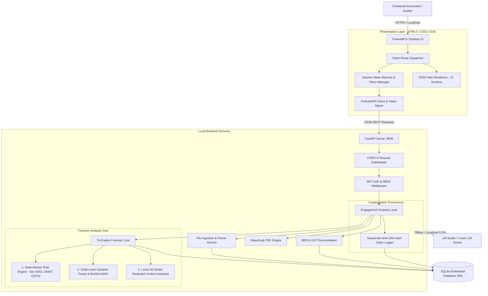

# FinAuditPro — Professional Statutory Audit Operating System (v1.2.0)

<p align="center">
  
  
  
  
  
</p>

---

## 🏛️ Executive Summary

**FinAuditPro** is an offline-first, professional desktop operating system engineered specifically for Indian **Chartered Accountants (CAs)**, audit managers, article assistants, and engagement partners. It provides a deterministic, mathematically rigorous platform for statutory audits under the **Companies Act 2013**, **Indian Standards on Auditing (SA 200–SA 700)**, **CARO 2020**, and **Tax Audit Form 3CD**.

Traditional auditing involves checking voluminous financial data manually, which is prone to oversight and fatigue. FinAuditPro serves as an **intelligent audit assistant** that helps practitioners detect anomalies, verify double-entry equality, enforce statutory tax limits, cross-reconcile bank/GST data, and draft structured electronic working papers with an unbroken evidentiary trail.

> **Important Principle:** FinAuditPro is an **audit assistant**, not a replacement for a Chartered Accountant. It never arbitrarily declares transactions "fraud" or "illegal". It flags items as *"Potential anomaly"*, *"Exception"*, *"Mismatch"*, *"Missing information"*, or *"Requires auditor review"* and provides the verifiable evidence trail for human sign-off (SA 200/230).

---

## ⚡ Key Highlights & Architectural Guarantees

* **🔒 100% Offline & Local Privacy:** Zero cloud telemetry or external network calls. All financial analytics, parsing, and AI co-pilot queries execute strictly on the practitioner's local workstation.
* **📐 Deterministic Integer-Paise Math:** Storage and calculations use exact integer paise ($1\text{ INR} = 100\text{ paise}$) preventing IEEE-754 floating-point rounding errors across ledgers.
* **🏗️ 4-Layer Domain-Driven Design (DDD):** Pure Python domain layer decoupled from presentation (HTML5/CSS3/SPA Desktop) and persistence (SQLite Embedded Engine).
* **🛡️ SQLite WAL with Immutability Triggers:** High-performance Write-Ahead Logging (WAL) storage with database-level triggers enforcing immutable audit trails (Companies Act Rule 11(g)).
* **🤖 Local AI Copilot via LM Studio:** On-device RAG assistant querying statutory standards and client datasets locally with prompt injection defenses and redacted context boundaries.
* **📋 Electronic Working Papers (SA 230):** Full maker-checker review workflows, threaded notes, and SQC 1 10-year archival sealing.

---

## ⚙️ Hybrid Forensic Tri-Engine Architecture

FinAuditPro implements a 3-tier forensic verification architecture:



### 1. Deterministic Rule Engine
- **Trial Balance Equality:** Mathematical validation ($Total\,Dr == Total\,Cr$).
- **Section 40A(3):** Cash payments exceeding ₹10,000 to a single person in a day (Clause 21(d) Form 3CD).
- **Section 269ST:** Cash receipts of ₹2,00,000 or more (Clause 31 Form 3CD).
- **GSTIN Format Verification:** 15-character statutory structure validation (2 State + 10 PAN + 1 Entity + 1 Z + 1 Check Digit).
- **Chronological & Sequence Testing:** Payment dates preceding invoice dates, and missing invoice/cheque number sequences.

### 2. Statistical & Machine Learning Engine
- **Benford's Law (First-Digit Forensic Standard):** Nigrini 1–9 digit distribution analysis and Mean Absolute Deviation (MAD).
- **Isolation Forest (Scikit-Learn):** Unsupervised multivariate anomaly detection across amount, velocity, and time-of-week.
- **3-Sigma Z-Score Univariate Outliers:** Statistical outlier flags on ledger deviations $> 3\sigma$.
- **Timing & Weekend Anomalies:** Identifies unusual journal postings booked on non-working days or fiscal cutoff dates.

### 3. Local AI Assistant
- Interactive Q&A for audit queries (*"Show Section 40A(3) violations"*, *"Summarize BRS variances"*).
- Explains findings with statutory context, expected vs actual values, and recommended audit actions.
- Context boundary defense prevents raw PII leakage; runs 100% locally with zero cloud API keys.

---

## 🚀 Quick Start

### 1. Clone the repository
```bash
git clone https://github.com/jeet9108/FinAuditPro-An-Interface-for-CA.git
cd FinAuditPro-An-Interface-for-CA
```

### 2. Setup Virtual Environment
```bash
# On Windows
python -m venv venv
venv\Scripts\activate

# On macOS/Linux
python3 -m venv venv
source venv/bin/activate
```

### 3. Install Dependencies
```bash
pip install -r requirements.txt
```

### 4. Run Test Suite
```bash
pytest backend/tests -v
```

### 5. Launch the Desktop Application
```bash
# Option A: Windows Batch script
start.bat

# Option B: Python launcher (cross-platform)
python run.py
```
> The application will initialize the local database schema and automatically launch `http://127.0.0.1:8000` in your default browser.

---

## 📚 Authoritative Documentation Map

All project documentation is structured in the [docs/](docs/README.md) directory:

| Section | Focus Area | Canonical Documents |
| :--- | :--- | :--- |
| **Inventory & Specs** | Full file manifest, routes, and gap review | [00-repository-inventory.md](docs/production/00-repository-inventory.md), [01-documentation-gap-analysis.md](docs/production/01-documentation-gap-analysis.md) |
| **Product Overview** | Executive summary, value proposition & ICAI alignment | [02-product-overview.md](docs/production/02-product-overview.md) |
| **User Manual** | 16-module end-to-end auditor workflow & desktop guide | [03-user-manual.md](docs/production/03-user-manual.md) |
| **Architecture** | System topology, DB schema, security model, offline AI | [05-technical-architecture.md](docs/production/05-technical-architecture.md), [presentation-diagrams.md](docs/presentation-diagrams.md) |
| **Presentation & DFDs** | DFD Level 0, Level 1, Deployment & Pipeline Diagrams | [presentation-diagrams.md](docs/presentation-diagrams.md) |
| **Statutory Rules** | Indian Income Tax & GST statutory algorithms and formulas | [08-audit-rules-and-calculations.md](docs/production/08-audit-rules-and-calculations.md) |
| **Test & Evidence** | Real-browser automated test results, Playwright logs & suites | [17-verification-and-test-evidence.md](docs/production/17-verification-and-test-evidence.md) |
| **Release Readiness** | Production sign-off checklist and release scorecard | [18-release-readiness-matrix.md](docs/production/18-release-readiness-matrix.md), [00-executive-verdict.md](docs/production-review/00-executive-verdict.md) |
| **Maintenance** | Filesystem taxonomy, cleanup audits & integrity reports | [repository-structure.md](docs/maintenance/repository-structure.md), [repository-audit.md](docs/maintenance/repository-audit.md), [cleanup-report.md](docs/maintenance/cleanup-report.md) |
| **Engineering** | Environment configuration, developer guide & test commands | [setup.md](docs/development/setup.md), [testing.md](docs/development/testing.md), [deployment.md](docs/deployment/deployment.md) |

For complete documentation details, visit the [Documentation Hub](docs/README.md).

---

## 🗂️ Project Repository Tree

```
FinAuditPro-An-Interface-for-CA/
├── backend/                    # FastAPI application & forensic business logic
│   ├── app/                    # Modular routers, services, models, & AI engine
│   ├── backups/                # Local encrypted/signed database backups
│   ├── logs/                   # Application operational logs
│   ├── reports_generated/      # PDF working paper & statutory audit outputs
│   ├── tests/                  # Pytest unit, integration, and security suites (118+ tests)
│   ├── uploaded_files/         # Local client evidence & data imports
│   └── finauditpro.db          # Canonical offline SQLite database
├── frontend/                   # Client-side desktop user interface
│   ├── css/                    # Modular styling & design system (styles.css)
│   ├── js/                     # Component controllers (api.js, app.js)
│   └── index.html              # Desktop SPA entry point (21 interactive views)
├── docs/                       # Comprehensive technical & regulatory documentation suite
│   ├── deployment/             # Deployment & environment guides
│   ├── development/            # Setup, testing, and developer manual
│   ├── maintenance/            # Repository structure & cleanup audits
│   ├── production/             # 18-volume production specifications
│   └── production-review/      # Executive verdict, scorecards, and defect registers
├── test_data/                  # Synthetic test fixtures & client trial balances
│   ├── aryan_fintech/          # Complete multi-ledger test datasets
│   └── hitansh_fintech/        # Complete multi-ledger test datasets
├── scripts/                    # Safe maintenance, browser tests & operational scripts
├── initialize/                 # Platform launcher scripts (macOS & Windows)
├── pyproject.toml              # Project metadata & Python packaging
├── requirements.txt            # Python production dependencies
├── setup.bat                   # Automated Windows environment installer
├── start.bat                   # Desktop application launcher
└── README.md                   # Primary system handbook
```

---

## 🔒 Security & Data Integrity

- **100% Air-Gapped Operation:** Zero telemetry, no external analytical pings or remote database connections.
- **Cryptographic User Authentication:** Uses `PBKDF2-HMAC-SHA256` (100,000 iterations) with salted hashes.
- **Tamper-Evident Audit Logging:** Sequential SHA-256 hash chains across all client actions fulfilling Companies Act 2013 Rule 11(g).
- **Strict Role-Based Access Control (RBAC):** Admin, Auditor, and Audit Staff tiers with strict engagement scoping.

---

## 📄 License, Security & Community

- **License:** [MIT License](LICENSE)
- **Security Policy & Architecture:** [SECURITY.md](SECURITY.md)
- **Code of Conduct:** [CODE_OF_CONDUCT.md](CODE_OF_CONDUCT.md)
- **Contributing Guidelines:** Please open an issue or pull request adhering to ICAI compliance standards and SA 230 working-paper integrity.

