# 📊 FinAuditPro — System Architecture, DFD & Presentation Diagrams

This document contains all architectural diagrams, Data Flow Diagrams (DFD Level 0 & Level 1), physical deployment topology, and core workflow diagrams extracted directly from the official project presentation ([`FinAuditPro_FY_Presentation.pptx`](../../FinAuditPro_FY_Presentation.pptx)).

---

## 📑 Table of Contents
1. [Core Audit Pipeline Flow (Slide 5)](#1-core-audit-pipeline-flow)
2. [High-Level Layered Architecture (Slide 11)](#2-high-level-layered-architecture)
3. [System Design & Component Architecture (Slide 7)](#3-system-design--component-architecture)
4. [Data Flow Diagram (DFD Level 0) (Slide 8)](#4-data-flow-diagram-dfd-level-0)
5. [Data Flow Diagram (DFD Level 1) (Slide 9)](#5-data-flow-diagram-dfd-level-1)
6. [Deployment Topology Diagram (Slide 10)](#6-deployment-topology-diagram)
7. [Implemented Modules Catalog (Slide 13)](#7-implemented-modules-catalog)
8. [Module Screen Gallery (Slides 14–22)](#8-module-screen-gallery)

---

## 1. Core Audit Pipeline Flow

The end-to-end journey from raw financial records to signed statutory audit reports:

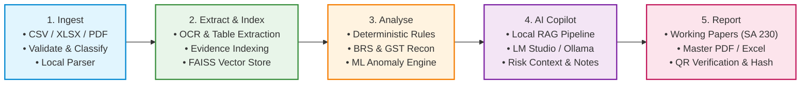

* **Zero Data Leaks:** Everything stays on the local machine in SQLite. Zero cloud analytics.
* **Faster Audits:** Auditors skip manual ledger cross-checking and focus on professional judgment.
* **Balanced Workload:** Engagement planning, risk findings, and working paper sign-offs unified in one workspace.

---

## 2. High-Level Layered Architecture

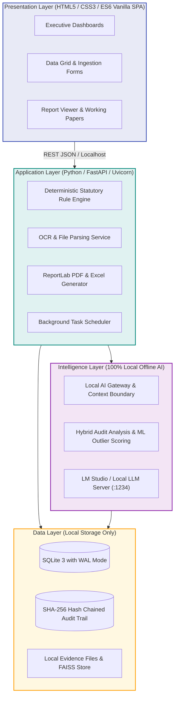

---

## 3. System Design & Component Architecture

Comprehensive system components, micro-services, data flow, and audit intelligence layers:

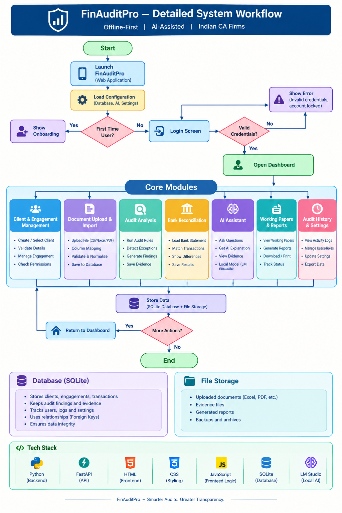

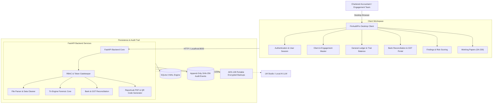

---

## 4. Data Flow Diagram (DFD Level 0)

Context-level data flow between the external entity (Auditor/CA) and the FinAuditPro operating system:

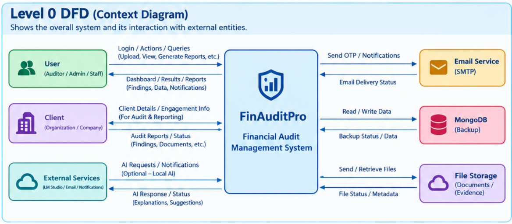

```mermaid
flowchart LR
    Auditor["Chartered Accountant / Auditor"]

    subgraph System["FinAuditPro System (0.0)"]
        FAP["FinAuditPro<br/>Audit Operating System"]
    end

    Auditor -->|1. Credentials & Auth Request| FAP
    Auditor -->|2. Client Info & Engagement Scope| FAP
    Auditor -->|3. Trial Balances, Ledgers, Bank Stmts, GST Files| FAP
    Auditor -->|4. Audit Inquiries & Verification Notes| FAP

    FAP -->|5. Authentication Token & Session| Auditor
    FAP -->|6. Exception Registers & Anomaly Alerts| Auditor
    FAP -->|7. Bank & GST Reconciliation Summaries| Auditor
    FAP -->|8. AI Advisory Insights & Evidence Citations| Auditor
    FAP -->|9. Final Signed Audit Reports & Working Papers (PDF/XLSX)| Auditor
```

---

## 5. Data Flow Diagram (DFD Level 1)

Detailed breakdown of sub-processes, data stores, and intermediate flows:

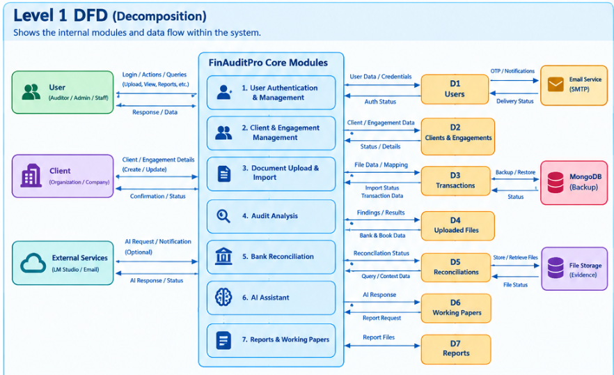

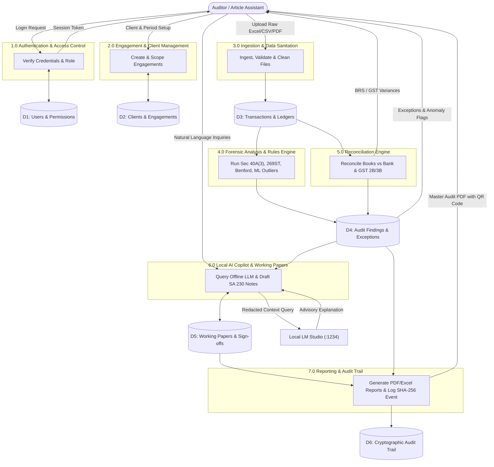

---

## 6. Deployment Topology Diagram

Physical workstation deployment architecture showing local execution boundaries:

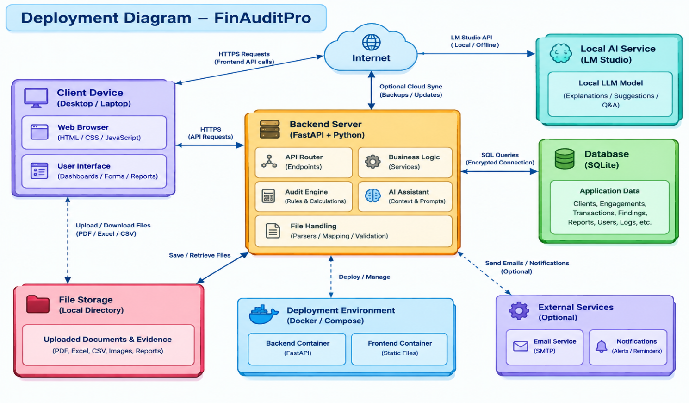

```mermaid
flowchart TD
    subgraph Host["Auditor Host Workstation (Windows / macOS / Linux)"]
        subgraph BrowserEnv["User Workspace"]
            Browser["Default Web Browser<br/>(Chrome / Edge / Safari / Firefox)"]
        end

        subgraph RuntimeEnv["Python Runtime Environment (Port :8000)"]
            FastAPI["FastAPI / Uvicorn Server"]
            DomainLogic["Domain Logic & Statutory Rules"]
            MLCore["Scikit-Learn ML Anomaly Engine"]
            ReportGen["ReportLab PDF Engine"]
        end

        subgraph LocalAIServer["Local AI Service (Port :1234)"]
            LMStudio["LM Studio Daemon / Local Inference"]
            LocalModel["Loaded LLM: Qwen 2.5 Coder 14B / Llama 3.1 8B"]
        end

        subgraph LocalDisk["Host Filesystem Storage"]
            SQLiteFile[("finauditpro.db (SQLite WAL Mode)")]
            EvidenceFolder["Evidence Uploads & PDF Working Papers"]
            BackupsFolder["AES-128 Encrypted Backup Archives"]
        end
    end

    Browser <-->|HTTP / WebSocket (127.0.0.1:8000)| FastAPI
    FastAPI <--> DomainLogic
    DomainLogic <--> MLCore
    DomainLogic <--> ReportGen
    DomainLogic <-->|Loopback REST (127.0.0.1:1234)| LMStudio
    LMStudio <--> LocalModel
    DomainLogic <--> LocalDisk

    style Host fill:#fafafa,stroke:#37474f,stroke-width:2px;
    style BrowserEnv fill:#e3f2fd,stroke:#1976d2,stroke-width:1px;
    style RuntimeEnv fill:#e8f5e9,stroke:#2e7d32,stroke-width:1px;
    style LocalAIServer fill:#f3e5f5,stroke:#6a1b9a,stroke-width:1px;
    style LocalDisk fill:#fff3e0,stroke:#ef6c00,stroke-width:1px;
```

---

## 7. Implemented Modules Catalog

From Slide 13 of the Presentation:

| Cluster | Implemented Module | Description |
| :--- | :--- | :--- |
| **Core & Administration** | **Dashboard** | Executive financial metrics, risk breakdown & health scorecards |
| | **Clients** | Master client directory, PAN/GSTIN registration, legal entity structure |
| | **Engagements** | Fiscal year audit scoping, statutory mandate selection & assignments |
| | **Users & RBAC** | Role-based accounts (Admin, Auditor, Staff) with session protection |
| | **Settings** | Retention policies, local AI endpoints, and backup configurations |
| **Data & Ledgers** | **Import & Cleaning** | Multi-format CSV/Excel parser, column mapping, and error reporting |
| | **General Ledger** | Full transactional ledger viewer with filtering and sorting |
| | **Trial Balance** | Real-time mathematical debit-credit balance verification |
| | **Parties & Volumes** | Counterparty risk aggregation and transaction velocity tracking |
| **Analytics & Checks** | **Reconciliation** | Automated BRS (Bank Reconciliation) and GSTR-2B vs 3B comparisons |
| | **YoY Comparison** | Multi-period trend and analytical procedures (SA 520) |
| | **Duplicates & Gaps** | Exact/fuzzy duplicate detection and cheque/invoice sequence gaps |
| | **Anomaly Detection** | Benford's Law (MAD), Isolation Forest ML, and 3-Sigma Z-Scores |
| | **Financial Statements** | Balance Sheet, Profit & Loss, and Cash Flow statement synthesis |
| **Audit Output & AI** | **Findings** | Central exception register with quantified risk scores and remediation |
| | **Working Papers** | Electronic SA 230 workpapers with evidence attachments & maker-checker |
| | **Checklist** | 15-category dynamic workprograms tailored to legal entity & risk |
| | **Reports** | Master statutory PDF report generation with verification QR codes |
| | **AI Assistant** | Air-gapped natural language auditor Q&A assistant |
| | **Audit Trail** | Append-only sequential SHA-256 hash chained event log |

---

## 8. Module Screen Gallery

High-resolution visual representations of the application views:

| Module View | Presentation Slide | Screenshot Artifact |
| :--- | :---: | :--- |
| **Executive Audit Dashboard** | Slide 14 | 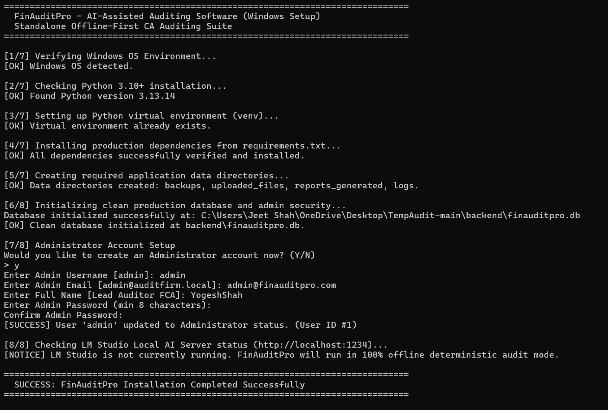 |
| **Client & Engagement Master** | Slide 15 | 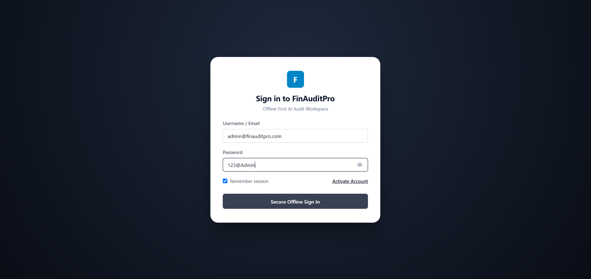 |
| **Trial Balance & Ledger Verification** | Slide 16 | 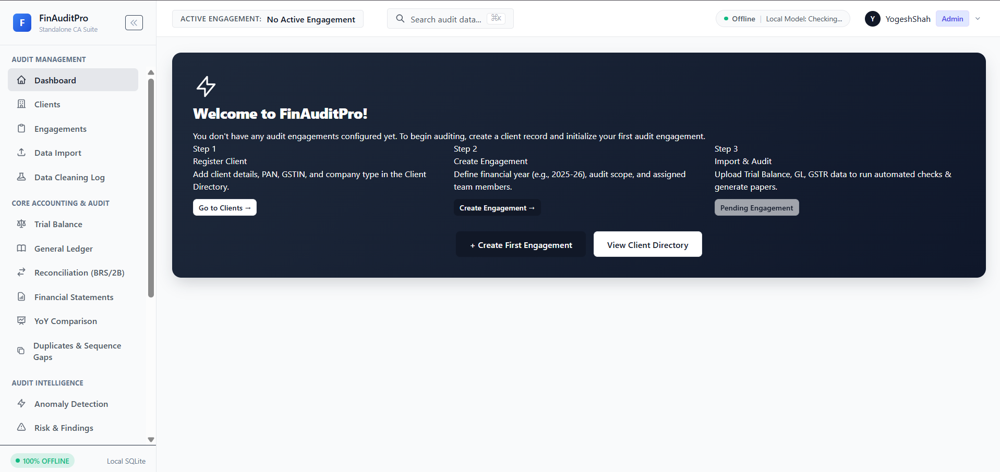 |
| **Bank Reconciliation (BRS)** | Slide 17 | 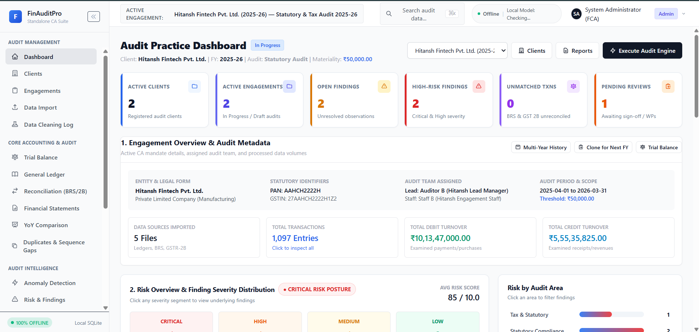 |
| **Duplicate & Gap Detection** | Slide 18 | 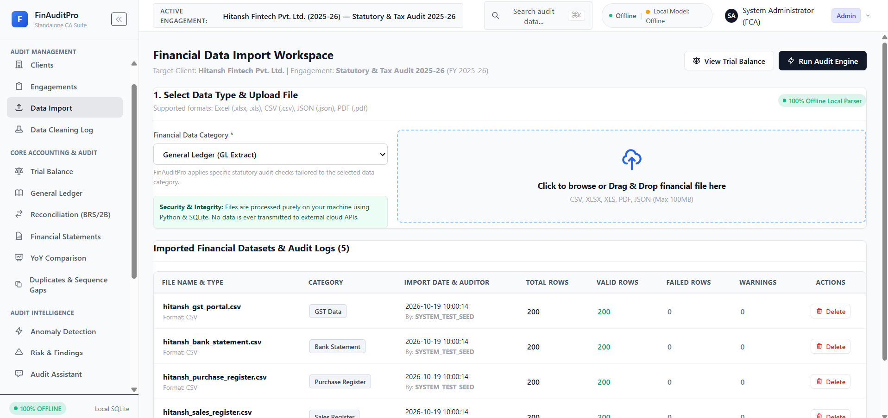 |
| **Anomaly Detection (Benford & ML)** | Slide 19 | 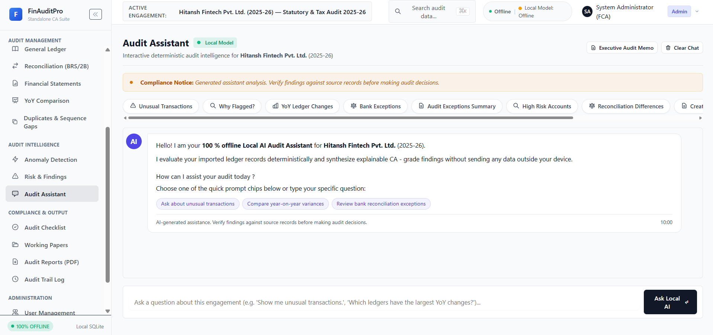 |
| **Working Papers (SA 230)** | Slide 20 | 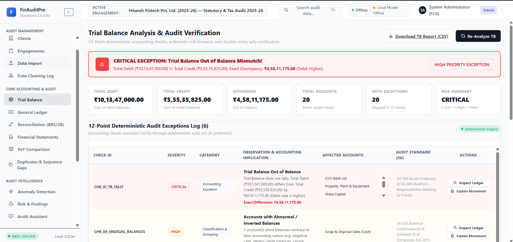 |
| **AI Assistant & Copilot** | Slide 21 | 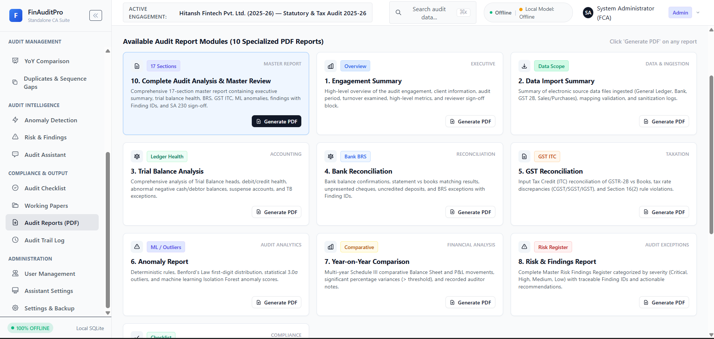 |
| **Report Generation & Verification** | Slide 22 | 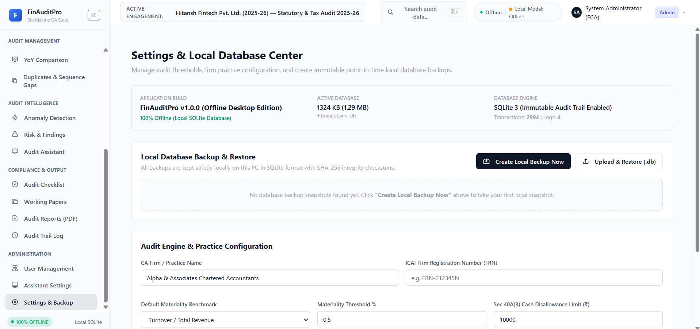 |
